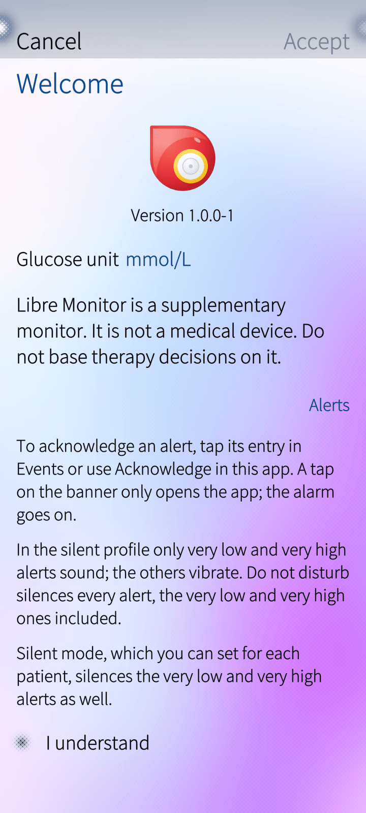
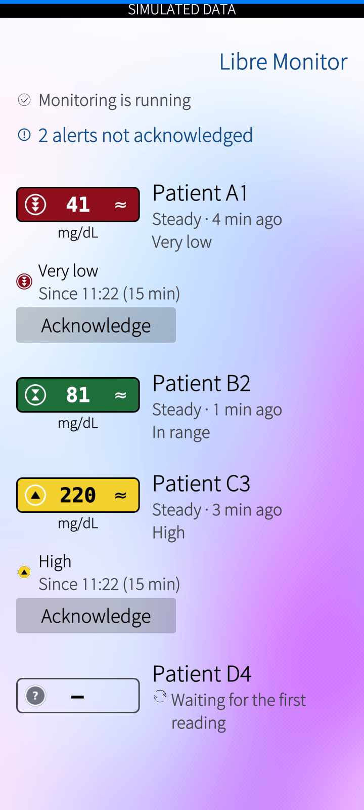
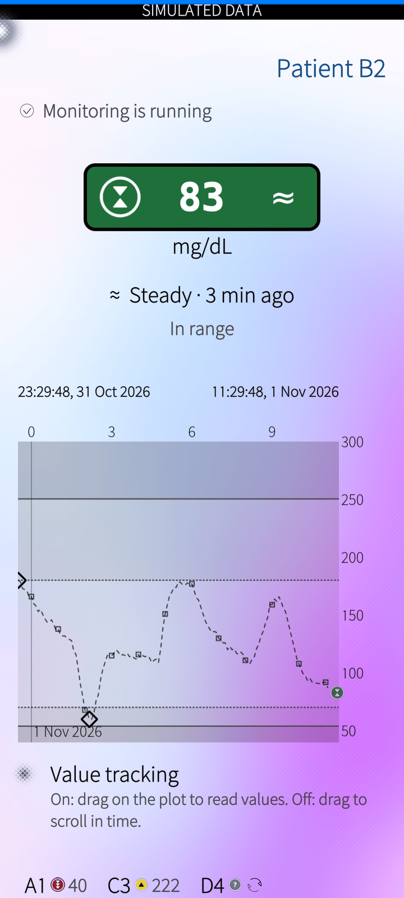
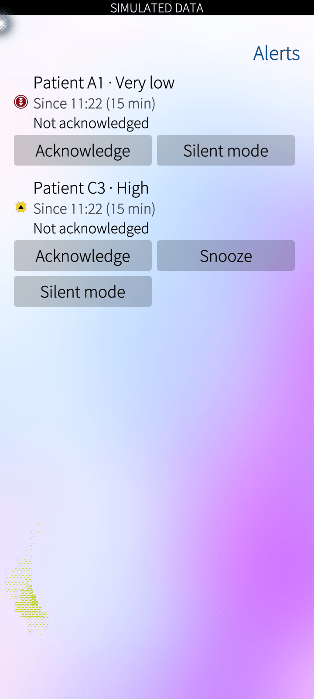
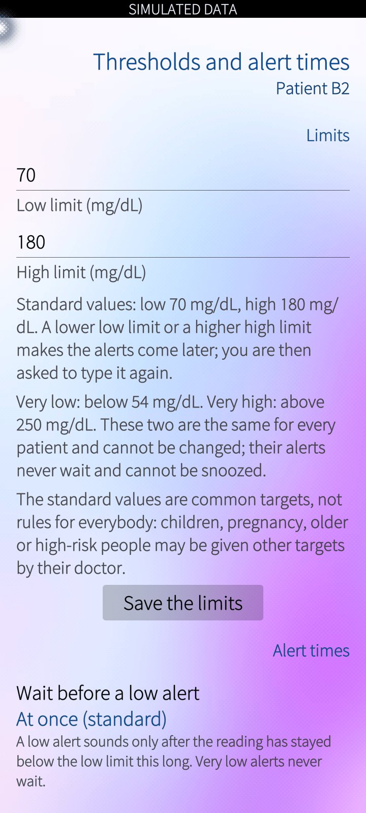
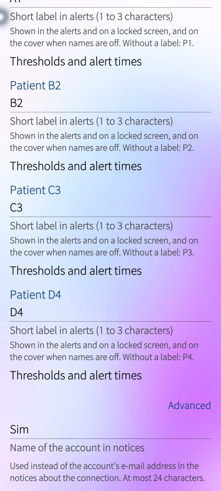
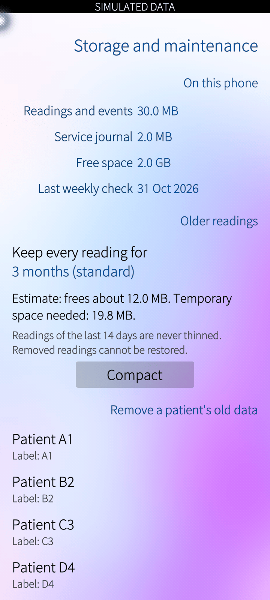

# Libre Monitor

A Sailfish OS application for people who look after someone who wears a FreeStyle Libre glucose sensor. It shows the readings of the people you follow, draws their glucose over the last hours, and raises an alarm on the phone when a level is too low, too high, or when no reading arrives any more.

Libre Monitor 1.0.0 is the first public release. It runs on a real phone with real data, but it has limits: read "Limits" below before you rely on it.

Libre Monitor is being tested with real FreeStyle Libre 3 sensors. Nothing has been checked yet with other types of sensor, so reports and help are welcome: see "Reporting a problem" below.

> **This app is a supplement, not a medical device.** It shows what the glucose source reports, with a delay, through an interface that its maker does not officially offer. It can be wrong, late or silent. Never rely on it alone for a decision about treatment or safety. If the phone is off, the system has closed the app, the phone has no network or the source stops, **nothing will alarm** until the app runs again.

Libre Monitor is free software (GPL-3.0-or-later). It has no connection with, and does not have the approval of, the maker of the sensor or of the sharing service it reads from.

If you find it useful, you can support the development on [Liberapay](https://liberapay.com/mbrami76).

## Screenshots

Taken on the emulator with simulated data. The black bar at the top of the pages says so; a release build does not show it.

| First start | Overview | Patient page | Alerts |
|---|---|---|---|
|  |  |  |  |

| Thresholds | Settings | Storage |
|---|---|---|
|  |  |  |

## What you need

- A phone with **Sailfish OS 5.2** (built for the Jolla Phone, aarch64).
- A sharing account of the sensor's service for the person you follow: the same account and password you would use in the official follower app.
- A network connection on the phone, mobile or Wi-Fi.

## Install

The application is built as one RPM package, `harbour-libre-monitor-1.0.0-1.aarch64.rpm`. It needs no software beyond what Sailfish OS provides. Copy the file to the phone and install it from a shell:

```
devel-su rpm -U harbour-libre-monitor-1.0.0-1.aarch64.rpm
```

To upgrade, install the new file the same way. Take a copy of the data folder first, with the monitoring service stopped, because a new version may convert the stored data to a format the older version cannot open. This applies in particular to a phone that still has a 0.1-x test package: the conversion at the first start of 1.0.0 is one-way. `docs/install.md` has the steps, including the way back.

To build the package yourself, see "Build from source" below.

## First start

1. The first page asks for the **unit** (mmol/L or mg/dL) and shows the safety statement above. You must tick "I understand" once.
2. **Set up your account**: enter the sharing account name and the password. The app tests the login, looks up the people the account follows, and you choose whom to follow and check each one's name and unit. Afterwards, under Settings, Patients, you can give each patient a **short label** of up to three characters. The label is what appears on notifications and, if you wish, on the cover; a patient without a label is called P1, P2 and so on, in the order of the configuration file. The full name never appears on a notification.
3. The first readings arrive within a few minutes. At the first start of a new version Sailfish asks you to allow the application's permissions: **Internet** (to reach the source), **Secrets** (to keep your login) and **Documents** (only for the file of the diagnostic report, if you agree to write one). Allow all three, or the alarms cannot work and the report cannot be written. After a phone restart the system asks once more to unlock the stored login.

## The screens

- **Overview**: one tile for each patient with the level, the trend arrow, how old the reading is and what the state is. A banner at the top says when someone needs attention. Pull down for Alerts, Settings, Storage and About. When monitoring has stopped, a button says so and offers to start it again.
- **Patient page**: the large current reading and the glucose over the last 12 hours, with zoom and scroll back in time. A tap on the large reading returns to the live view. The page also shows the alerts of this patient and the sensor block (a shortened identifier, when it started and when it was last seen, and, in the first hour of a new sensor, that it is warming up). Its pull-down leads to the thresholds and alert times and to silent mode.
- **The cover** (the card on the home screen while the app runs): the reading of the one or two patients who most need to be seen.
- **Settings**: unit, which feeds the plot shows, the side of the value axis, the patient's name on the cover, the account, the patients (their labels and the entry to each one's limits and alert times), "Show the value in alerts", language (the phone's, English or Italian; the pages change at the next start of the app).
- **Storage**: how much space the data takes, the full-resolution window, compaction and the purge of old data (see "Your data").

## The levels

Every reading falls in one of five bands. The limits are whole numbers in mg/dL; the app shows mmol/L if you prefer.

| Level | Reading | Mark |
|---|---|---|
| **Very low** | below 54 mg/dL (3.0 mmol/L) | red round badge with an outer ring, three triangles pointing down |
| **Low** | 54 up to below 70 mg/dL | orange round badge, one triangle down |
| **In range** | 70 to 180 mg/dL | green round badge, two triangles facing each other |
| **High** | above 180 up to 250 mg/dL | yellow round badge, one triangle up |
| **Very high** | above 250 mg/dL (13.9 mmol/L) | purple round badge with an outer ring, three triangles up |

Colour is used only for these five levels; everything else (waiting, no data, stopped) is shown with an icon and words. A grey badge with a question mark means the level is not known, for example because the last reading is too old.

The arrows show the direction in which the glucose is moving: ↓ falling fast, ↘ falling, ≈ steady, ↗ rising, ↑ rising fast.

You can change the **low limit** and the **high limit** for each patient on its thresholds page (the very low and very high limits are the same for everybody); the same page sets the alert times, and shows the history of your changes. A stricter value is saved at once. A looser value than the standard one asks you to type it again, on a screen that does not show the value you just asked for. The standard limits are common targets, not rules for everyone: children, pregnancy, older or high-risk people may be given other targets by their doctor.

## The alerts

| Alert | It starts when | Reminders while unanswered | Snooze |
|---|---|---|---|
| **Very low** | a reading is below 54 | every 2 minutes | no |
| **Low** | a reading is below 70 | every 15 minutes | yes |
| **Very high** | a reading is above 250 | every 2 minutes | no |
| **High** | a reading has been above 180 for 15 minutes (you can change this) | every 30 minutes | yes |
| **No data** | no new reading for 15 minutes (you can set 5 to 60) | every 30 minutes | yes |

**Very low and very high alerts start at once and cannot be delayed or snoozed.** Only silent mode, which you set yourself, can withhold their sound.

Each alert wakes the screen and shows a banner. The banner's bold line says what it is about ("VERY LOW GLUCOSE"); the patient's short label is the first line of the details, and the app shows **no glucose value on a locked screen**, so a passer-by learns nothing. A setting, off by default, shows the value as well.

### Acknowledging an alert

- **A tap on the banner does not acknowledge the alert.** It dismisses the banner and opens the app; the alarm goes on.
- To acknowledge: open the **Events** page of the phone and tap the entry of the alert (or delete it), or press **Acknowledge** in the app (on the overview tile, the patient page or the alerts page). The reminders then stop. For a very low or very high alert this is only a pause: if the level is still in the very low or very high range 5 minutes (very low) or 15 minutes (very high) later, the alert starts again.
- **Snooze** (low, high and no data): 15, 30, 60 or 120 minutes of quiet. If the situation gets worse in the meantime, the snooze ends at once.

An alert does not end on the first reading back in range, so it does not flicker around a limit: it ends after two readings in a row that are at least 5 mg/dL inside the limit. When a low, high, very low or very high alert ends before anyone acknowledged it, a short entry is left in the Events page ("... ended, you did not acknowledge it") so that nothing disappears unseen.

### No data

If no reading arrives, the app counts the time. After about 5 minutes the screen greys the value out; after the limit (15 minutes by default) an alarm says that there is no data and **why**: the source cannot be reached, it has sent nothing new, the connection was stopped for protection, the app was not running, or the app is waiting for your approval after a restart. While a sensor is warming up after a replacement, no "no data" alarm is raised.

## Silent mode, Do not disturb and the phone's profiles

- **Silent mode** is set **for one patient** (long press on its tile, the patient page's pull-down, or the alerts page): **1 hour, 4 hours, until tomorrow at 06:00, or without a limit**. It withholds the sound and the vibration of that patient's alerts, **the very low and very high ones included**; everything else still happens (the banner, the screen wake-up, the entry in Events). It is always visible: a struck-through speaker on the tile, the patient page and the cover. Setting it while an alert is sounding stops the sound at once. "Without a limit" asks for a confirmation that names the very low and very high alerts. It does not cover "no data", interruption, approval and connection notices.
- **Do not disturb** (the phone's own switch) silences every alert, the very low and very high ones included. The banner and the screen wake-up remain. The app tells you when it is on.
- **The silent profile** keeps the sound of the very low and very high alarms; the others only vibrate.

## When nothing can be said

The app can only alarm while it runs. A notice in the notification list shows the time of its last sign of life; an old time means that monitoring has stopped, and a tap starts it again. If the phone was off or the app was not running for more than 15 minutes, the app tells you afterwards that monitoring was interrupted from ... to ...; it does not raise a "no data" alert for that past gap.

## Your data

- Everything stays **on the phone**. There is no server of ours, no telemetry, no account with us. The app talks only to the glucose sharing service you gave it the account for.
- Your account password is kept in Sailfish's secret storage, not in a file.
- The readings are stored locally and never changed; only compaction and the purge, which you start yourself, remove some of them. The names of the patients are kept in the configuration file, not in the database.
- The app **neither exports nor imports data**. The readings are also held by the glucose sharing service, for as long as it keeps them.
- **Compaction** frees space by thinning old readings. Readings newer than the **full-resolution window** (3 months by default; 14 days, 1, 3, 6 or 12 months) are never touched, and the window can never be shorter than **14 days**. Of the older current readings (about one a minute) it keeps **one every 5 minutes** and removes the others; the history graph, the logbook (entries the source records at times of its own choosing; the app keeps them but does not show them), marks, events and sensors are kept in full. Before it runs, the Storage page shows an estimate of the space it frees and of the **temporary space needed during compaction**, and asks you to confirm. **What compaction removes is deleted for good: the app cannot restore it.** If there is not enough free space, or it cannot be read, compaction refuses and nothing is removed.
- **Purge** removes everything that is older than a chosen age for **one patient**: 3, 6, 12 or 24 months. It covers that patient's readings of every kind, the logbook, marks, events, sensor records and alert entries; the patient and the settings stay, and so does everything newer than the chosen age. The Storage page first shows an estimate of the space the purge recovers. Then it asks you to confirm, naming the patient and the age, to type the patient's label, and to press a last button. **A purge is irreversible and leaves no record.**
- The **diagnostic report**, which the app may offer after repeated problems, contains no glucose value, name or account detail. It is written to a file in Documents only if you agree; the app sends nothing. The dialog shows the developer's address and the project page (https://michelebrami.it/LibreMonitor); you send the file yourself.

## Limits

- **Not tested yet:**
  - Sensors other than the FreeStyle Libre 3. Other types may report data in a different way (units, trend, update interval); no information about them has been gathered yet.
  - More than one real patient. Several patients have only been run against simulated scenarios, so how often each one is updated on a real account, and how quickly an alarm arrives for each, is not known.
- The source is an interface that its maker does not document or promise. It can change or stop without notice; the app can then show nothing, or old data (always marked as old).
- The alarms were tested with simulated data and on an emulator. The application also ran for 12 days on one real Jolla 2026 phone, with one real FreeStyle Libre 3 sensor and one patient. Real alarms occurred in that time and the application behaved correctly. That does not exclude cases nobody has met yet: other settings and several patients have not been tried. Check the alarms yourself in the first days and do not rely on them alone.
- In the test, a new sensor was shown 2 to 3 minutes after the 1-hour warm-up.
- Alerts need the app's background service to run. The system, the battery saver or a restart can stop it; the notice in the notification list tells you.
- Only English and Italian texts exist.
- Some features are not built yet; see "Roadmap".

## Roadmap

Ideas for later versions, in no fixed order and without dates. They are not promises.

- Other types of sensor, through further data sources. This needs data and help from people who use those sensors.
- Testing and tuning with several real patients.
- Manual entry of data (notes, insulin, meals, weight and other measurements), shown with the glucose.
- Predictive alerts and a history of past alerts.
- An "expiring soon" notice for the sensor.
- A screen that shows which protection limits were reached, when and how often.
- Reading intervals as a setting, the add-on state in Settings, and a line on the overview that reports an interruption.
- Data sources written in other languages or shipped as separate packages.
- Network restrictions for each data source, if the platform allows them.

## Troubleshooting

| What you see | What to do |
|---|---|
| "Waiting for your approval" | After a phone restart the app waits for you to allow access again; open the app and approve. |
| The value is grey, "no reading since ..." | The source sent nothing for a while. The cause is written next to it. Nothing is lost: the missing stretch is filled in when the source delivers it. |
| "Stopped for protection" with Retry and Re-enable | The app stopped a connection because the source behaved in an unexpected way. Press Retry; if it happens again the app offers to write a diagnostic report. |
| No sound on an alarm | Check Do not disturb, the profile, and whether silent mode is set for the patient (a struck-through speaker). The banner and the Events entry always appear. |
| The notification list shows "monitoring stopped" | Tap it to start the app again. |

## Build from source

The project uses the Sailfish SDK (3.13 or later) with qmake and the Docker build engine. Build for the phone (aarch64) or the emulator (i486) from the SDK; do not use the desktop kit for packaging. In a shadow build folder outside the source tree:

```
sfdk -c target=SailfishOS-5.1.0.11-aarch64 build <path to the source>
```

The RPM is written to `RPMS/`. The Harbour validation of the package:

```
sfdk -c target=SailfishOS-5.1.0.11-aarch64 check --suites harbour RPMS/<package>.rpm
```

The unit tests run on the PC inside the SDK's i486 target, with the `hostbuild` configuration. `CONTRIBUTING.md` has the exact commands. The release packages are built without the development switches (a simulated data source and a base-URL override), so they contain neither the code nor a runtime option for them.

## Reporting a problem

Write to `info@michelebrami.it` and say what you did, what you expected and what happened, with the version shown on the About page. **Do not send real health data**: no glucose values, names, account details or screenshots of the patient pages. A diagnostic report written by the app is safe to send; it contains none of these. For a security problem, see `SECURITY.md`.

## Development

Most of the code was written with the help of a generative AI assistant; the author reviewed and tested everything that is published. See `CONTRIBUTING.md`.

## Documentation

- `docs/requirements.md`: what the application does, as numbered requirements.
- `docs/architecture.md`: how it is built, with diagrams of the processes, the data flow, the scheduler, the alert life cycle, the service life cycle and the storage.
- `docs/code-map.md`: what every file is for, and how a request travels through the code.
- `docs/install.md`: installing, upgrading and removing the package.

## Licence

Copyright (C) 2026 Michele Brami. GPL-3.0-or-later; see `LICENSE`.
