# Architecture

This page describes how Libre Monitor is built: the components, how data flows between them, the interface between the window and the service, what is stored and for how long, the security model, and what is deliberately not done. `requirements.md` has the numbered requirements; their numbers (`REQ-...`) are quoted here where a rule comes from one.

## Overview

Libre Monitor is one application, one installed binary (`/usr/bin/harbour-libre-monitor`), that runs in four modes:

| Mode | What it is | Opens the store | Reads the configuration |
|---|---|---|---|
| Window (UI) | The QML application the user sees | yes, read-only | yes, and writes it |
| Service | A headless instance started by D-Bus activation; it does the monitoring | yes, the only writer | yes |
| Adapter | A short-lived child process of the service that talks to the data source | no | no |
| Provisioning | A terminal tool (`--provision`) that stores an account and a connection, then tells the service | no | yes, and writes it |

The Harbour rules allow only one executable in a package, so the adapter and the provisioning tool are the same binary started with an argument that selects the mode. The window and the service are separate processes so that monitoring continues when the window is closed (REQ-ARC-03, REQ-ARC-07).

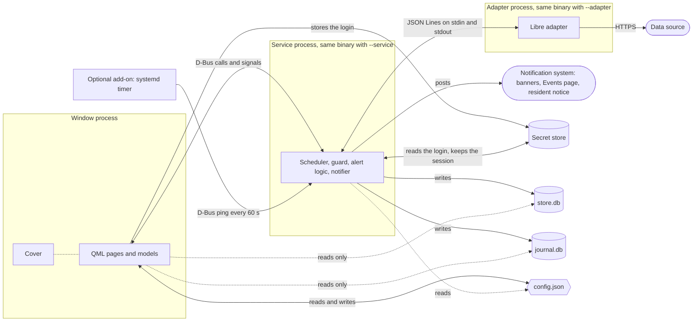

*Processes and files: the three long-lived processes and what they touch. Solid arrows write or call, dotted arrows only read. The adapter reaches nothing but the data source: it has no access to the store, the configuration or the secret store, and it receives the login inside a command.*

Each file is written by one process, with the one exception of the configuration, which the window and the provisioning tool both write:

| File | Written by | Read by |
|---|---|---|
| `store.db` (readings, events, marks, quarantine) | service | service, window |
| `journal.db` (the service's own history) | service | service, window |
| `config.json` (people, names, intervals, language) | window and provisioning tool | service, window |
| `settings.json` (the service's non-secret state, for example the notification ids) | service | service |
| `ui-settings.json` (the window's own preferences) | window | window |

## Components

**Adapter.** All knowledge of the data source lives here (REQ-ARC-06). The Libre adapter logs in with the follower account, follows a regional redirect, lists the people the account follows, and fetches the current reading, the history graph and the logbook. It turns what it receives into normalised records, with the unit the source reported and the timestamp converted to UTC (the original string is kept). It holds no durable state: a session token goes back to the service as an opaque blob. The source is an unofficial interface, so the adapter treats every field as untrusted and quarantines what it cannot interpret. Replacing the adapter does not change the core.

**Adapter link and guard.** The service starts the adapter as a child process and speaks JSON Lines over its standard input and output (contract v0, REQ-ADP-02). It checks every message and every record: size, rate, schema, unit, plausible range, timestamp (REQ-ADM-02). Violations are scored with a decay. When the score crosses a limit the connection is stopped in a persistent state, `disabled-by-guard`, which only the user can lift (REQ-GRD-05 to REQ-GRD-08). The guard defends against faults and resource abuse, not against hostile code (REQ-GRD-12). Only adapters compiled into the application and listed in its registry can run (REQ-ADP-05).

The guard keeps two separate protections. The first is the score. Every violation reported by the link adds a weight to the score of its connection (10 for a hard violation, 1 to 3 for a soft one), and the score halves every 30 minutes, so that two hard violations within about half an hour trip a connection and one never does. The second is a circuit breaker for the adapter process itself.

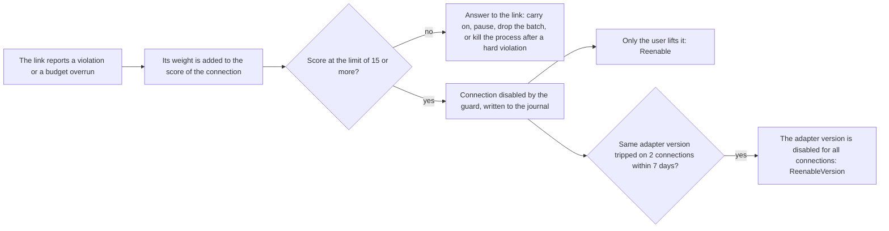

*How a violation becomes a stop. The numbers are the defaults of the build; the stop is stored in the journal, so it survives a restart of the service and of the phone.*

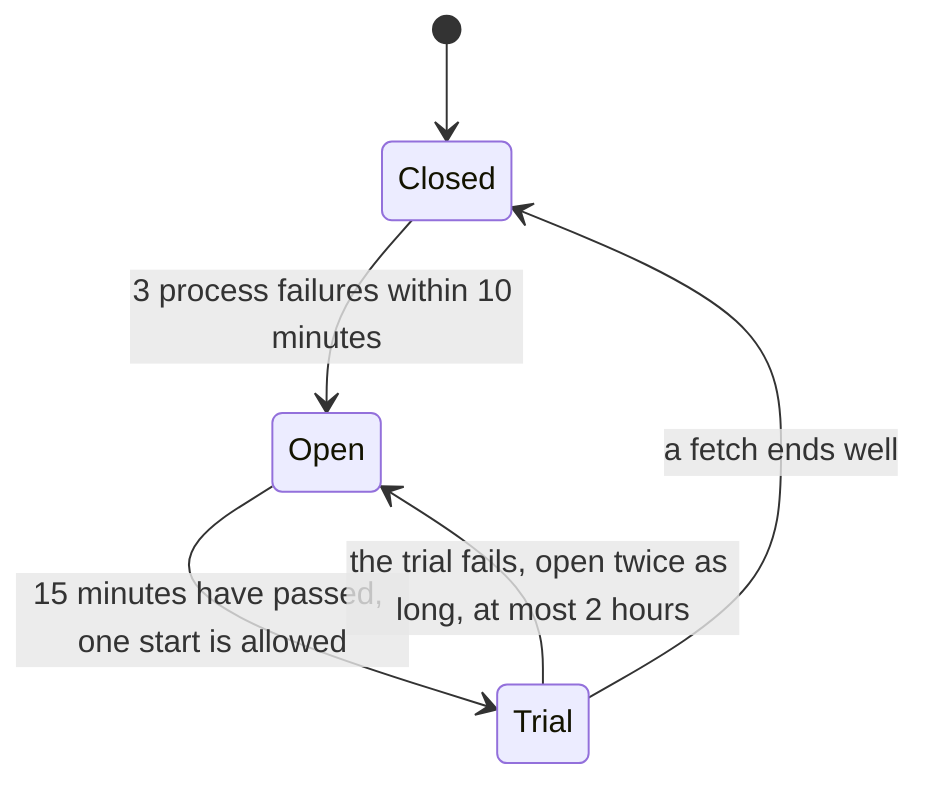

*The circuit breaker. A process failure is a crash, a non-zero exit, a kill, or a start that did not complete. While the circuit is open the connection waits in `backoff`; it is never stopped for the user by the breaker. A separate allowance limits how often a process may be started.*

**Scheduler.** For each connection and each person it holds a small state machine (`idle`, `fetching`, `backoff`, `needs-attention`, `disabled-by-guard`). The next fetch of the current value is computed from the sensor timestamp of the last reading plus the nominal interval, not from a fixed timer (REQ-SCH-02). Errors are handled by class: transient errors back off with jitter; a token that the source rejects is answered by one new login and one repeat of the command, while a login that the source refuses stops the connection at once for the user to fix and is never retried by itself; a rate limit stops that connection for a long time and raises the polling floor; a protocol change stops it and raises a warning (REQ-SCH-04). A staleness clock per person records when the newest stored current reading was measured and why newer data are missing (REQ-SCH-06, REQ-SCH-07).

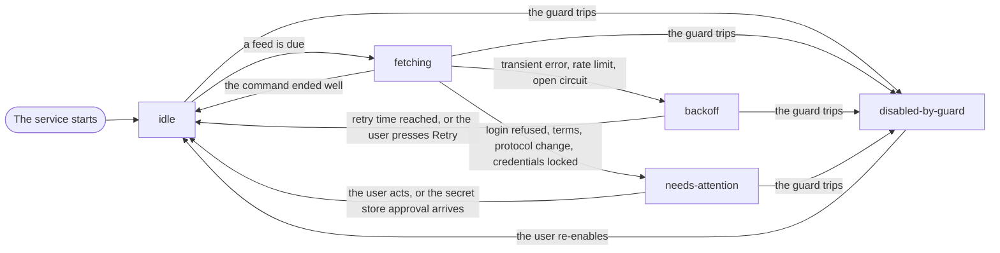

*The state of one person on one connection. After a restart the service restores `disabled-by-guard`, the persistent `needs-attention` causes and a running rate-limit hold from the journal; everything else starts in `idle`. A connection runs one command at a time; when several are due, `current` goes before `graph` and `graph` before `logbook`.*

The `current` feed is not polled by a timer. After each successful fetch the scheduler works out when the next reading should have been published:

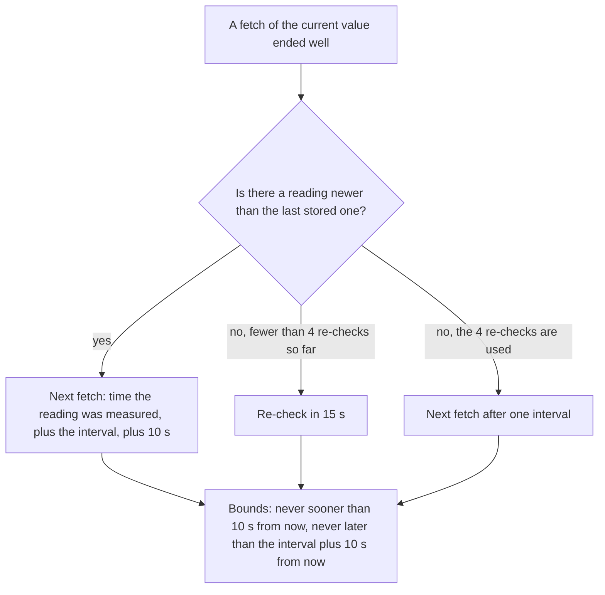

*The polling rhythm of the current feed with the default numbers (nominal interval 60 s). When no reading has arrived for 30 minutes the interval is doubled for each further 30 minutes, up to 5 minutes. After a rate limit it is never shorter than the raised floor.*

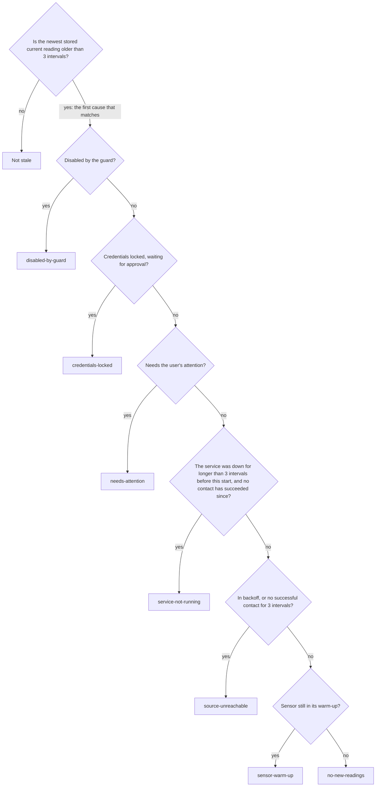

*The staleness clock. Without any stored reading it counts from the start of monitoring. The cause is what the window and the missing-data alert show.*

**Store.** An SQLite database of readings and events, append-only (REQ-DAT-04). Every record carries its unit, its measurement time in UTC, its ingest time and a source tag. The store knows people only by an opaque UUID, never by name. Invalid records go to a quarantine table, unmodified. Marks ("ignore this record, with a comment") are an overlay and never change the record. The store has a schema version and a migration step for each version (REQ-STO-10).

**Journal.** A second SQLite database for the service's own history: start and stop records, a heartbeat at least once per nominal sensor interval, connection-state changes, storage checks, and the alert, threshold and silent-mode entries. It is append-only apart from the rules under "Retention". A gap in monitoring is the interval between the last heartbeat or stop record and the next start record; it is shown as "monitoring not running" and counts as missing data (REQ-SCH-09, REQ-SCH-10).

**Feeds.** The source delivers several kinds of data, and each is a feed that is part of the source tag: the current value (about one reading a minute), the history graph (one point every five minutes, delayed), the logbook and the sensor information. Where two feeds disagree about the same instant, both are stored and neither wins; the latest value and the alerts use the current feed only (REQ-DAT-09).

**Alert logic.** A pure function of readings, thresholds and time, with no access to the store or the clock of its own, so it is tested by feeding it stories. Five bands (very low, low, in range, high, very high) come from four thresholds per person; only the low and high limits can be edited (REQ-THR-01). Each person has three alert slots: low (L or LL), high (H or HH) and missing data. The more severe level takes the slot, so the user never gets an L and an LL alert at once. A slot goes through `normal`, `pending`, `active`, `acknowledged` and `snoozed`; `cleared` is the transition that ends an alert, not a state it rests in. Around that there are persistence times, a hysteresis so that an alert does not flicker around a limit, escalation, snooze and reminders (REQ-ALR-01). A missing-data alert fires whatever the guard state is, so a switched-off source never hides a blind spot (REQ-ALR-02).

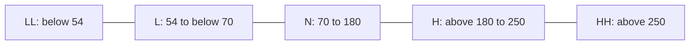

*The five bands with the standard limits in mg/dL. The comparison is strict and made on the stored value, so 70 and 180 are in range. A person's own L and H may differ; LL and HH are fixed.*

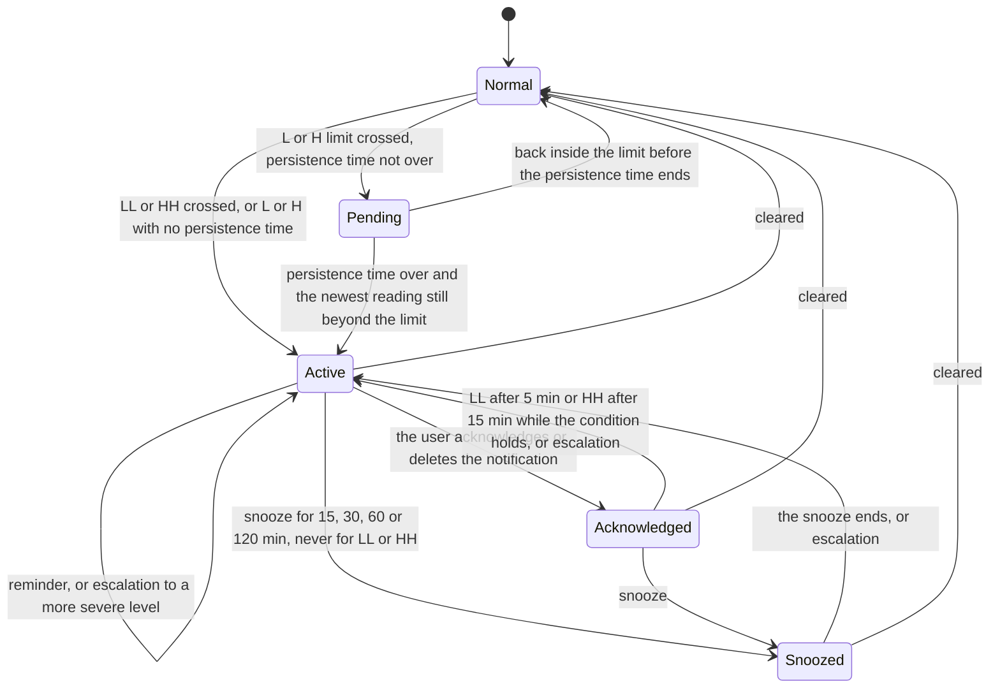

*The life cycle of one alert slot. Reminders come every 2 min for LL and HH, 15 min for L, 30 min for H and for missing data. An alert is cleared after two consecutive readings that are back inside the limit by at least 5 mg/dL; if the reading is still within the margin of the level below, the alert is lowered to that level instead (LL to L, HH to H) and stays in its state. Persistence defaults to none for L and 15 minutes for H. For missing data, the slot becomes pending when the newest reading is older than the staleness limit, active when it is older than the person's missing-data limit (15 minutes by default), and it is cleared at once by any new reading or by a sensor warm-up.*

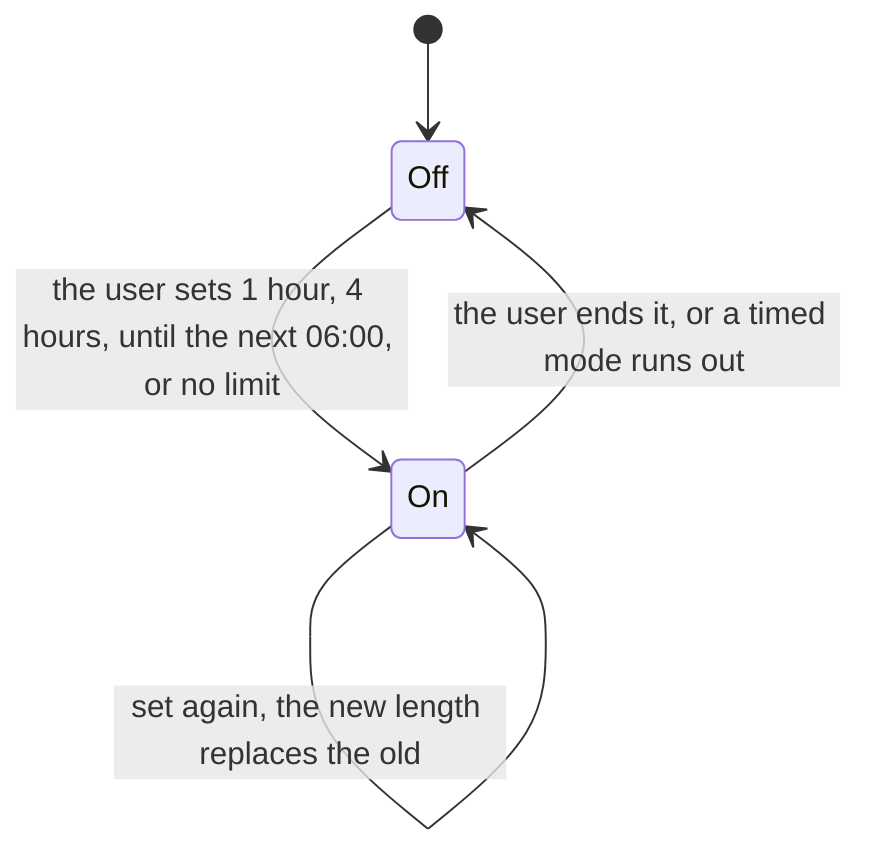

*Silent mode of one person. It does not touch the alert states above: alerts are raised, shown and journaled as always, LL and HH included, and only the sound and vibration of the notification are withheld. It never covers missing data, the interruption notice or the notices about the monitor itself. It is journaled and survives a restart.*

**Notifier.** Turns alert effects into system notifications: banners with a short, label-only summary, sounds, reminders, the entry that stays in the Events page, and one resident notice that shows the time of the last heartbeat and the active alerts. The resident notice survives the death of the service, so a stale time reveals a stop (REQ-ALR-06). Silent mode and the phone's Do not disturb withhold sound and vibration but never the banner or the record (REQ-ALR-09).

**Maintenance.** Compaction and purge run inside the service, one at a time, as cancellable jobs with progress. Polling and alerts continue meanwhile: readings fetched while the store is busy wait in a bounded queue in memory (REQ-STO-15).

**Window (UI).** QML pages on Silica with C++ models behind them. It never talks to the source. It reads the store and the configuration, and sends commands to the service over D-Bus. Presentation (colour, icon, text) is decided here; the core stores only the semantic state (REQ-UI-07). Colour is reserved for the five glucose bands.

## Data flow

1. The wake-up of a background activity (not a plain timer, which does not run reliably while the phone is suspended; REQ-ARC-08) tells the scheduler that a fetch is due.
2. The scheduler asks the adapter link for a fetch. The link starts the adapter, which authenticates with the credentials sent in the command itself, fetches, and returns batches of records with a completion marker.
3. Each record is checked against what the adapter declared and against the registry (metric, unit, feed, range, time format), and once more by the store when it writes. A record that fails goes to the quarantine table, unmodified. On the current feed a reading is stored only if it is newer than the last stored one. Valid records are written in one transaction per batch: the same key with the same value writes nothing, so a repeated window is harmless; the same key with another value or unit keeps the first and adds an entry to the ingest log. While the store is busy (see Maintenance) a batch waits in a bounded queue in memory.
4. When new data were stored, the service raises an event for that person. The alert coordinator reads the newest current reading from the store and passes it, with the thresholds, the staleness information and the clock, to the alert logic. The result is a list of effects.
5. The coordinator writes the journal lines among the effects and hands the others to the notifier, which carries them out. The event also becomes the `DataChanged` signal, which tells the window to reload.
6. The window shows the reading, the trend and its age. A reading older than the staleness limit loses its colour and shows its age; an old value is never shown as current (REQ-UI-05, REQ-UI-09).

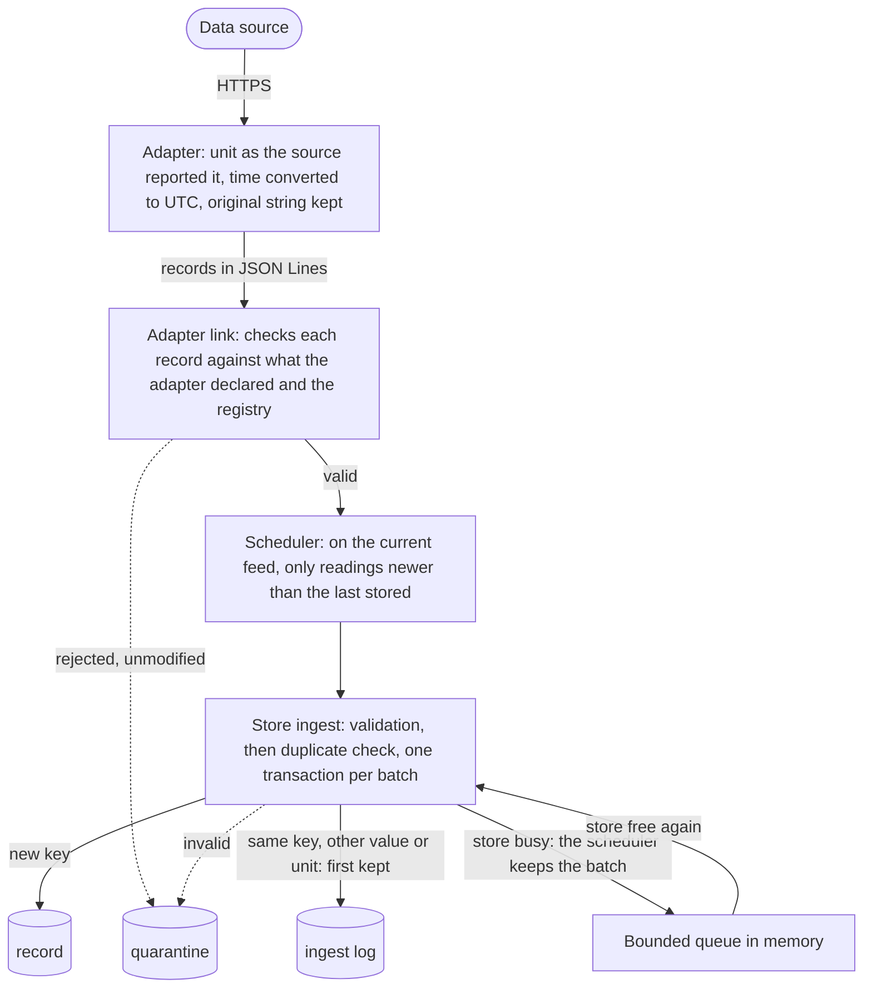

*From the source to the store. Every table named here is in `store.db`.*

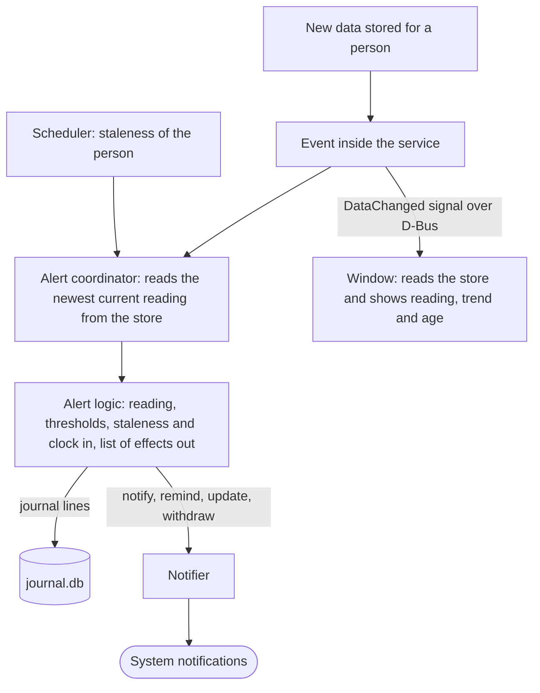

*From the store to the screen and the notifications. The store can also hold derived records, but the application does not write any today.*

## The D-Bus interface

The service owns the name `it.michelebrami.libre-monitor` on the session bus, with the object `/it/michelebrami/libre_monitor` and the interface `it.michelebrami.libre_monitor.Service`. At most one instance runs; an instance that cannot take the name exits at once (REQ-ARC-09). A call to any method, or to the standard Peer ping, starts the service when it is not running; this is also how the optional add-on revives it.

Simple values use plain D-Bus types. Structured results travel as one JSON text, so that adding a field never changes a signature. People are named by their opaque UUID, connections by their identifier; no name, credential or token crosses the interface except in the answer to the account discovery, which carries the names of the people the account may follow.

Methods: `Start`, `Stop`, `Status`, `Retry`, `Reenable`, `ReenableVersion`, `ReportHandled`, `DiagnosticReport`, `CredentialsChanged`, `IntervalsChanged`, `ConfigChanged`, `Discover` (answered later), `Alerts`, `AcknowledgeAlert`, `SnoozeAlert`, `SetThresholds`, `SetSilent`, `EndSilent`, `StartMaintenance`, `CancelMaintenance`.

Signals: `DataChanged`, `StateChanged`, `StalenessChanged`, `Warning`, `DiagnosticReportProposed`, `MaintenanceProgress`, `MaintenanceFinished`, `GapDetected`, `SilentChanged`, `AlertChanged`.

Development builds add `DevInject`, which feeds synthetic events to the notifier. It is absent from release packages.

## Service life cycle and upgrade

The service is started by D-Bus activation: the first call to its name, from the window, from the provisioning tool or from the add-on's timer, starts it. A start takes the D-Bus name first; an instance that finds the name taken exits at once and has written nothing. Otherwise it opens the journal and the store, works out why it is starting from the newest start, heartbeat or stop entry of the journal and the clocks (`first-start`, `after-restart`, `after-stop`, or `after-missing-stop` when nothing was written because the service was killed or the phone lost power), writes the start record, shows the resident notice, reports a gap in monitoring longer than 10 minutes, and starts the scheduler.

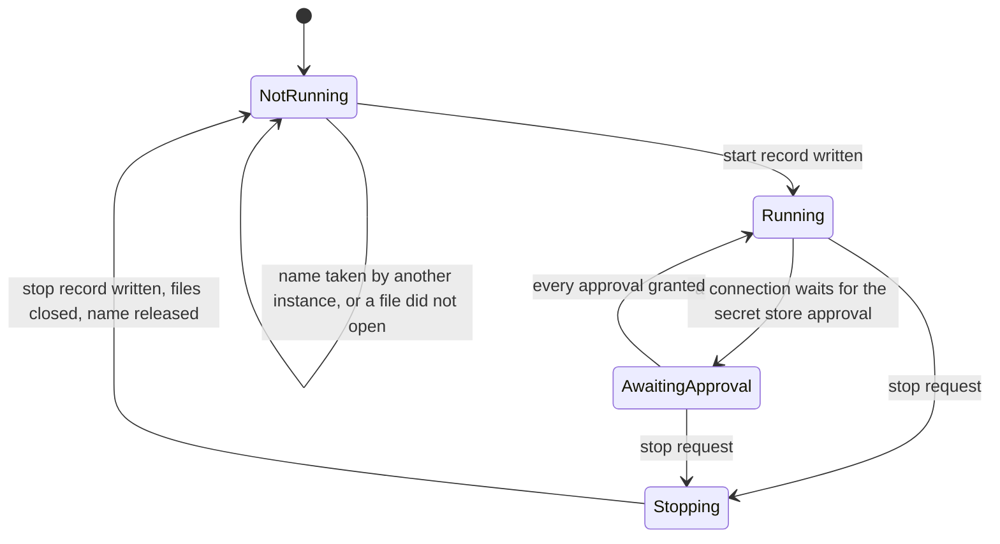

*The states of the service. `AwaitingApproval` is shown as "waiting for approval" in the window and in the resident notice; the other connections keep running.*

While it runs, the service has no timer of its own. The platform's keepalive wake-up is the only clock that keeps running while the phone sleeps, so every action hangs on it: it ticks the scheduler and the alert logic, writes a heartbeat to the journal when about a minute has passed on the boot-time clock (not on the wall clock, which can jump), raises the approval request again every 15 minutes while one is pending, runs the weekly storage check, and refreshes the resident notice at most every 30 minutes. After each tick it arms the next wake-up for the earliest of the next due time of the scheduler, the next due time of the alert logic and the next heartbeat.

A package may not run install scripts, so nothing stops the old service when the package is upgraded or removed. The package therefore installs a stamp file with its version, and the service compares it with its own version at every heartbeat:

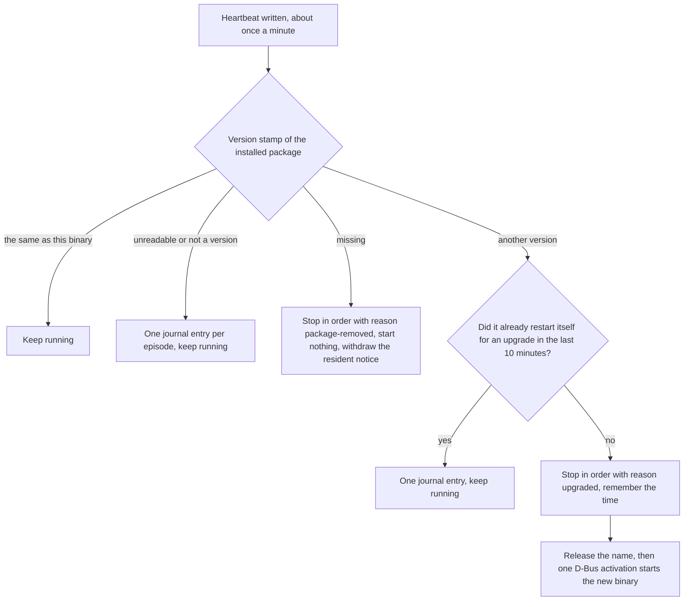

*Self-replacement after an upgrade. The ten-minute guard stops a broken install from restarting the service every minute. A stop for an upgrade is quiet: the new service replaces the resident notice within a second.*

A stop has one of seven reasons, written into the stop record: `term`, `int` and `hup` (signals), `requested` (the D-Bus method `Stop`), `name-lost`, `upgraded` and `package-removed`. The sequence is the same for all of them. A running maintenance job is cancelled and rolled back, and discoveries in flight are ended. The scheduler stops starting commands and ends the adapter processes (up to 4 s). Readings still held in memory are given up to 5 s to reach the store, and 10 s is the limit for the whole stop; what is still held after that is lost and logged as `readings-lost`, and the next start fetches the overlapping windows again. Then the stop record is written, the resident notice says that monitoring stopped (except after an upgrade or a removal), the files are closed and the name is released.

## Storage and journal rules

- The store is append-only. Adapter data are never modified or deleted, except by compaction and purge, which the user starts and confirms, and which delete permanently (REQ-DAT-04, REQ-STO-05, REQ-STO-17).
- Adapter data never overwrite manual data, and the other way round (REQ-DAT-05). The unique key is (person, type, timestamp, source), which makes re-fetching harmless (REQ-DAT-06).
- The unit is stored with every value, as the source reported it. Conversion between mg/dL and mmol/L happens only for display, always from the stored value (REQ-DAT-12, REQ-DAT-13).
- Names live in the configuration file, never in the store (REQ-SUB-01, REQ-SUB-02). The configuration file is the key that re-identifies the people; its permissions are restricted. The store is pseudonymous, not anonymous.
- The thresholds' history is append-only, so the question "what were the limits when this alert fired?" can always be answered. A change that makes a limit looser than the standard needs a challenge, and no comment is stored (REQ-ALR-05, REQ-THR-02).
- Schema changes ship a migration step, applied one version at a time, and a test that opens a fixture of each earlier version (REQ-STO-10).

## What is stored where

The store (`store.db`) and the journal (`journal.db`) are two SQLite files so that maintenance on one never blocks the other. The store holds the following tables:

| Table | What it holds |
|---|---|
| `record` | Every reading and event of every feed, plus manual and derived records. One row per (person, metric, time, source, entry id) |
| `mark` | Marks: "ignore this record", with a comment, as an overlay on a record |
| `sensor` | One row per person and sensor: activation time, warm-up length, model, first and last time seen |
| `quarantine` | Records that failed validation, exactly as received, with the reason |
| `ingest_log` | The audit of each adapter session: start, end, violations, pauses, dropped batches, conflicts, readings lost |
| `compaction` | One row for each compaction run that removed something: the range, the counts, the version of the rule |
| `subject` | The opaque ids of the people. No names |
| `meta` | The schema version and the flags that allow a compaction or purge to delete |

The journal holds one table of entries, each with a kind: `heartbeat`, `start` and `stop` (the lifecycle), `prune` and `storage-check` (maintenance), `connection-state` (what the guard and the scheduler persist), `alert`, `threshold` and `silent` (the alert logic's history), and `version-check` (the version stamp). In the store, records, marks, quarantine and the ingest log refuse an update, and so does every journal entry. Deletes are refused as well, except by the jobs named under "Retention", which set a flag in `meta` for the length of their transaction; compaction rows are never deleted.

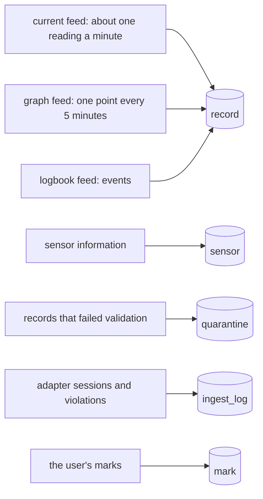

*Where each feed lands in `store.db`. The source tag of a record names its feed, so the feeds are kept apart even where they overlap in time.*

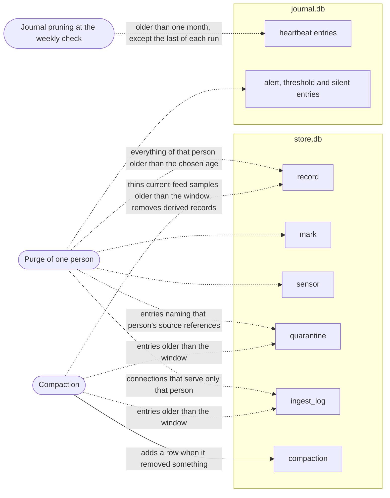

*What each deleting job touches (dotted arrows delete, the solid arrow adds). Compaction leaves the graph feed, the logbook, marks, sensor rows, manual records and the journal alone. A purge leaves the other people, the compaction rows and the lifecycle, connection-state, storage-check and version-check entries of the journal alone. Pruning adds a `prune` entry.*

## Retention

- **Full-resolution window.** Readings newer than the window (default 3 calendar months, never less than 14 days) are never thinned (REQ-STO-13).
- **Compaction.** Older current-feed readings are thinned to the one nearest the start of each five-minute slot (UTC). The history feed, the logbook, marks, events and sensor records stay in full. Derived records (the store supports them, but the application writes none today) and quarantine and ingest-log entries older than the window are removed. A run that removed something appends a compaction record. Before it deletes anything it shows an estimate and checks that the space for rebuilding the database file is available (REQ-STO-05 to REQ-STO-07, REQ-STO-16).
- **Purge.** For one person at a time, everything older than 3, 6, 12 or 24 months: readings of every feed, derived records, quarantine and ingest log, marks, events, logbook entries, sensor records, and that person's alert, threshold and silent-mode entries in the journal. It needs a typed confirmation, it leaves no record, and it never touches the 14-day floor (REQ-STO-17).
- **Journal.** Heartbeats older than one calendar month are removed at the weekly storage check, except the last one of each run so that every gap keeps its start. Start and stop records are never removed (REQ-SCH-14).
- **Storage check.** Once a week the service records the free space. If it is smaller than three times the size of the data, the application says so and points to compaction (REQ-STO-01, REQ-STO-02).

## Security model

- **Secrets.** The account login and the session blob are kept only in a Sailfish Secrets collection (device lock), never in a file, a log, a command line or an environment variable (REQ-SEC-01, REQ-SEC-05). After a phone restart the first access needs a one-time approval by the user; the service requests it itself and shows a "waiting for approval" state.
- **Adapters are untrusted input**, even though they are compiled in (REQ-ADM-04). The adapter process does not open the store, read the configuration file or access the secret store. It receives credentials only inside the `authenticate` command (REQ-ADP-11, REQ-SEC-06). Its standard error is captured for diagnostics only, scrubbed of secrets, and never parsed as data.
- **No data leaves the phone.** There is no telemetry and no server of ours. The only network traffic is from the adapter to the host of the data source (REQ-SEC-02). A diagnostic report is a file that the user reads and sends; the application sends nothing.
- **No glucose value on a locked screen.** Notifications carry a short label of the person and the alert level. The value appears only if the user turns that setting on.
- **Development switches.** The override of the source's base URL, plain HTTP and the simulated data source exist only in builds made with the `devsource` flag. Release and Harbour packages are built without it and have neither the code nor a runtime switch (REQ-SIM-06). A development package has its own application identity, shows a permanent SIMULATED DATA indication and keeps simulated records apart from real data (REQ-SIM-09).
- **Sandbox.** The application runs sandboxed under the Harbour rules. The process boundary between service and adapter limits faults, not privileges, because both run as the same user in the same sandbox (REQ-GRD-12).

## What is deliberately not done

- No export and no import of data. The readings are also held by the source service for as long as it keeps them.
- No writing back to the source, no cloud service of ours, no telemetry, no accounts with us.
- No acceptance of the source's terms on the user's behalf: if updated terms must be accepted, the application says so and stops (REQ-SRC-03).
- No guessing: a timestamp that does not match the documented format, or a unit that cannot be determined, is quarantined, not repaired (REQ-DAT-11, REQ-DAT-13).
- No merged view of conflicting feeds and no precedence rule between them (REQ-DAT-09).
- No way to delay or snooze a very low or very high alert. Only the visible silent mode, which the user sets, withholds their sound (REQ-THR-01, REQ-ALR-09).
- No alarm that depends on the window being open, and no claim that the service always runs: when it cannot, the resident notice and the gap record say so.
- No out-of-tree adapters and no adapter executables of their own in the Harbour package (REQ-ADP-05, REQ-ADP-16).
- No second executable, no `.service` file and no install scripts in the main package (REQ-PKG-01).
- Not a medical device, and not to be relied on for treatment decisions (REQ-SAF-01).
